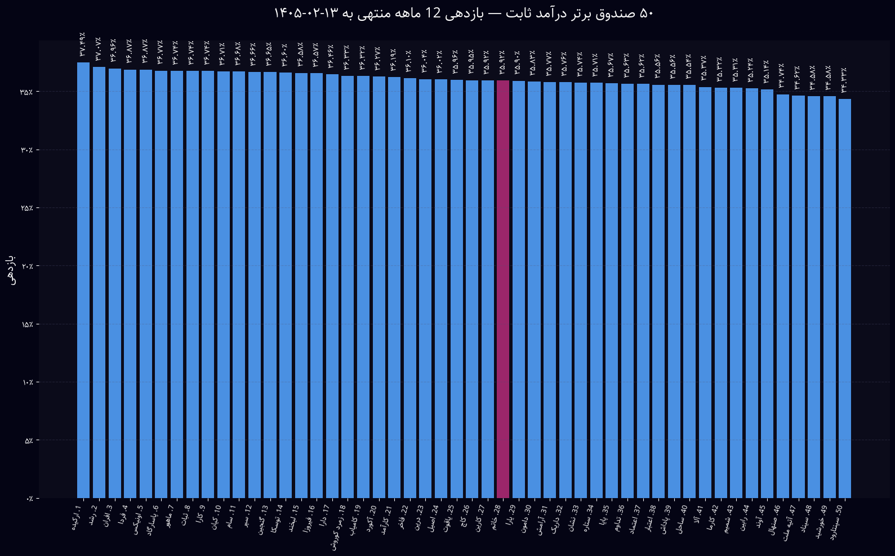
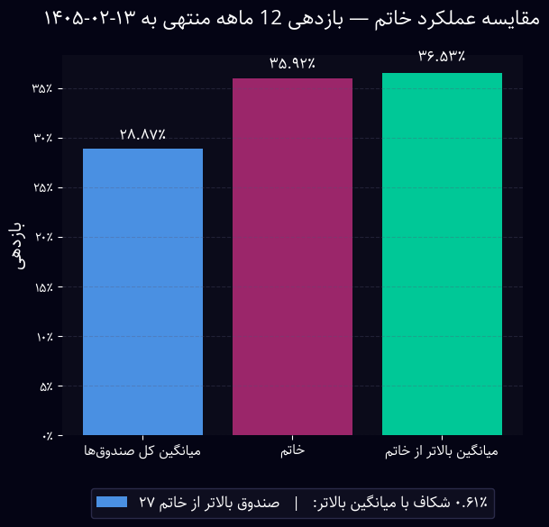

# 📊 Fixed-Income Funds Analysis  
A comprehensive, data-driven analysis of Iranian fixed-income investment funds — including multi-period return evaluation, ranking, and performance benchmarking against the **Khatam Fund**.  
All charts, rankings, and comparisons are generated automatically using Python, Matplotlib, and FinPy-TSE.  

---

## 🚀 What This Project Does  
This repository analyzes return performance across dozens of Iranian fixed-income funds, producing insightful charts and comparisons such as:

- 📈 Multi-period return calculation (2-week, 1M, 2M, 6M, 12M)  
- 🏆 Ranking the **Top 50 funds** in each period  
- 🎯 Visual highlight of the target fund (**Khatam**)  
- ⚖️ Benchmarking Khatam vs:
  - Average of all funds  
  - Average of funds outperforming Khatam  
- 📉 Return gap analysis  
- 🖼️ Automatically generated charts stored in the `charts/` folder  
- 🔄 Optional GitHub Actions workflow to automatically re-run analysis daily  

Everything is clean, modular, and easy to extend.

---

## 🧠 Why This Exists  
The fixed-income fund space in Iran is large and noisy.  
This project creates **structured insight** by:

- Normalizing data  
- Comparing performance across consistent time windows  
- Highlighting a fund of interest (Khatam)  
- Visualizing results in clear, publication-ready charts  

Whether you’re a researcher, investor, or data geek, this analysis gives you a powerful snapshot of market behavior.

---

## 🗂️ Repository Structure
```bash
fixed-income-funds-analysis/
│
├── fund_analysis.py        # Main analysis & visualization engine
├── analysis.ipynb          # Clean 2-cell Jupyter workflow
├── requirements.txt        # Project dependencies
├── README.md               # You are here :)
│
├── charts/                 # Auto-generated charts
│
└── .github/
└── workflows/
└── update.yml      # Optional auto-update GitHub Actions
```


## ⚙️ Installation
Install dependencies:
```bash
pip install -r requirements.txt
```

Run the main script:
```bash
python fund_analysis.py
```

# 🧪 Features in Detail
## 📌 Multi-Period Return Analysis
The script automatically calculates returns for:

📍 2 weeks
📍 1 month
📍 2 months
📍 6 months
📍 12 months
Each period is plotted separately.

## 🥇 Top 50 Funds Ranking
For every time period, the script:

* Sorts all funds by performance
* Selects the Top 50
* Highlights Khatam Fund in a distinct color
* Adds Persian labels rendered correctly (reshaped RTL text)
* Saves a clean, dark-mode chart

# 🖼️ Sample Outputs
## 📈 Top Funds Chart




🎯 Khatam Benchmark Chart




## 🧩 Technologies Used
🐍 Python
📘 pandas
📈 matplotlib
🏦 FinPy-TSE
🇮🇷 PersianTools (Jalali dates)
🔤 arabic-reshaper + python-bidi
📓 Jupyter Notebook


## 👨‍💻 Author
Developed as part of a deep-dive analysis into Iran’s fixed-income fund landscape.

Feel free to fork, extend, or send PRs.
